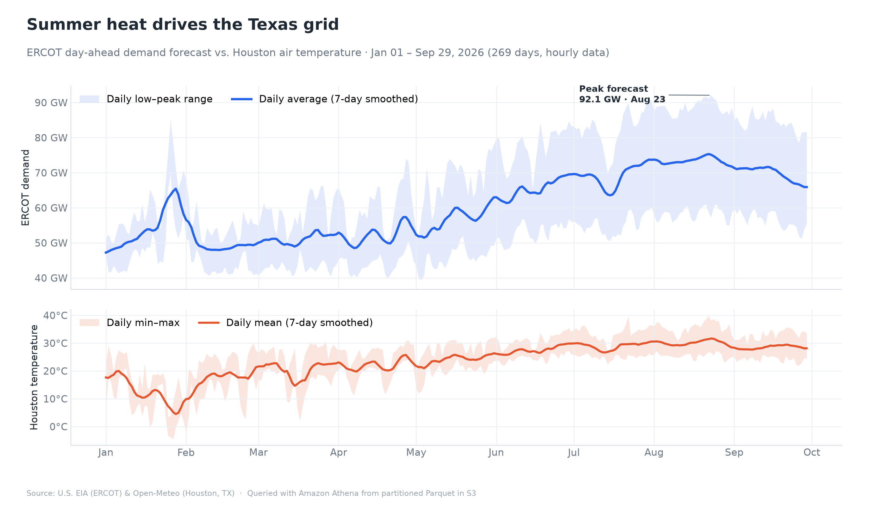
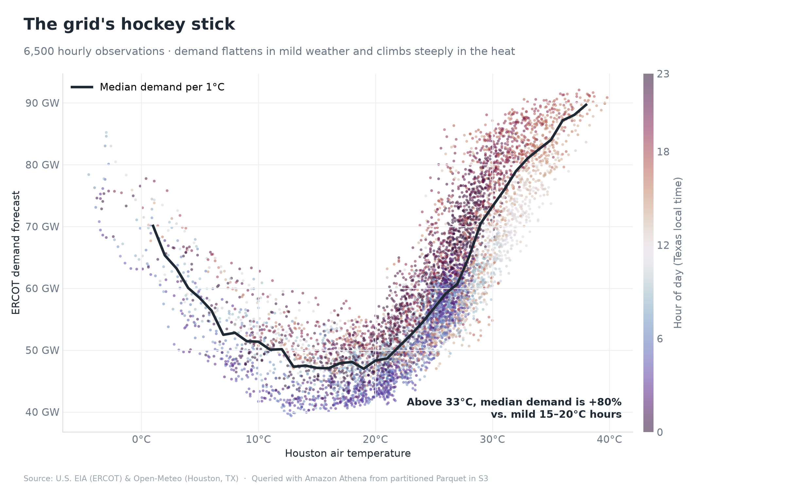
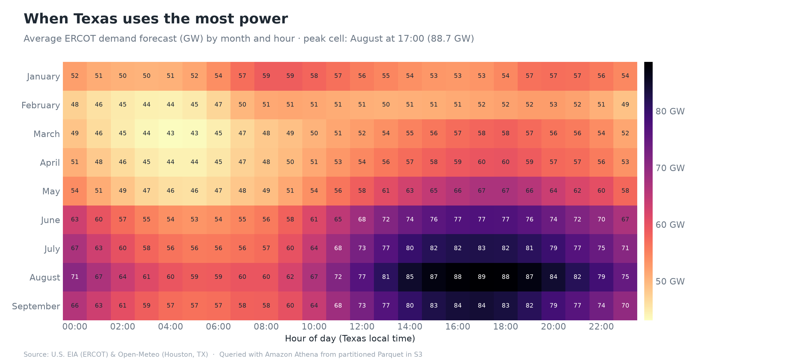
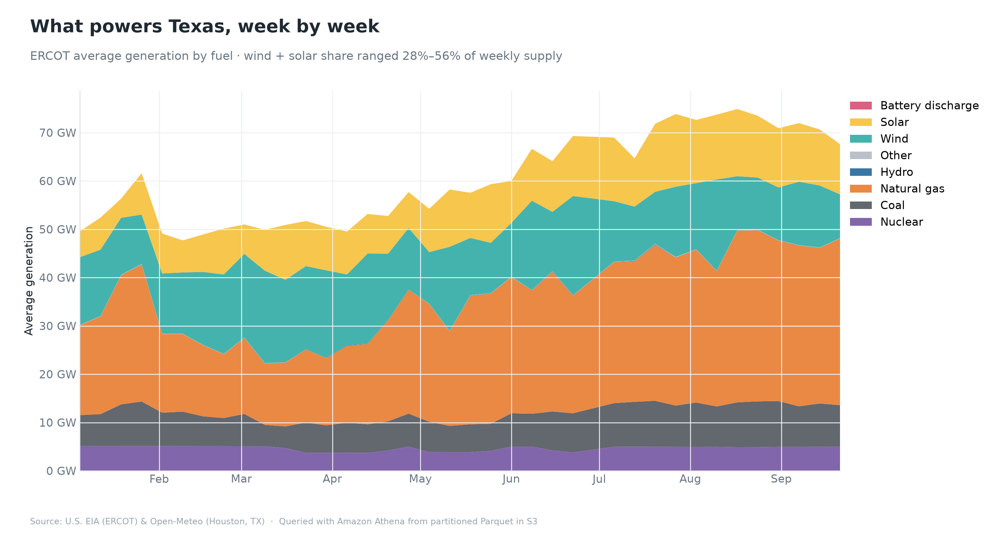
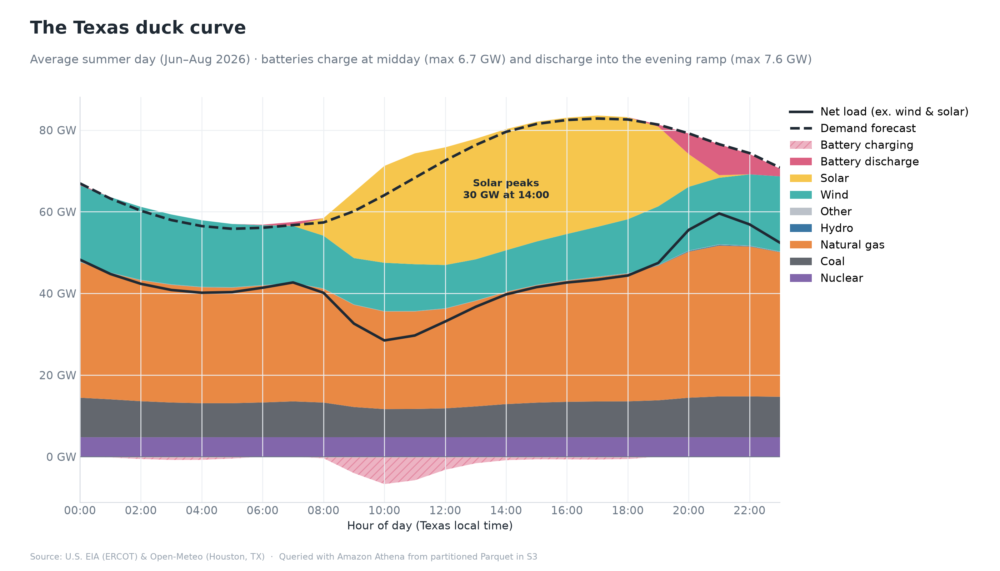
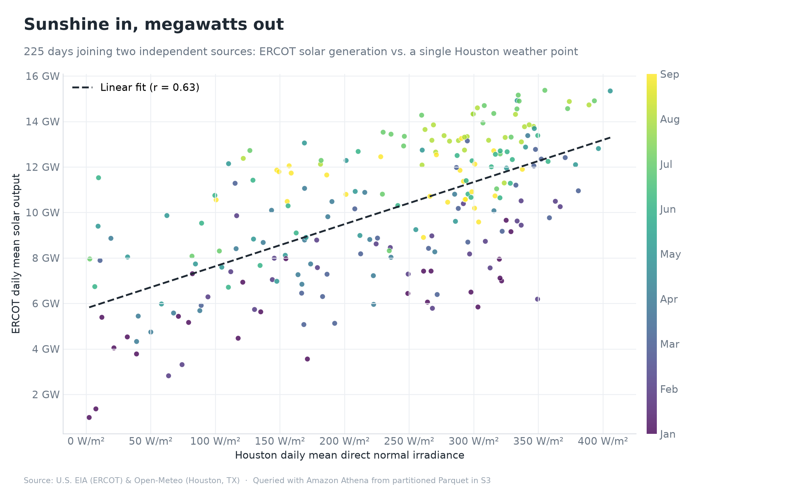
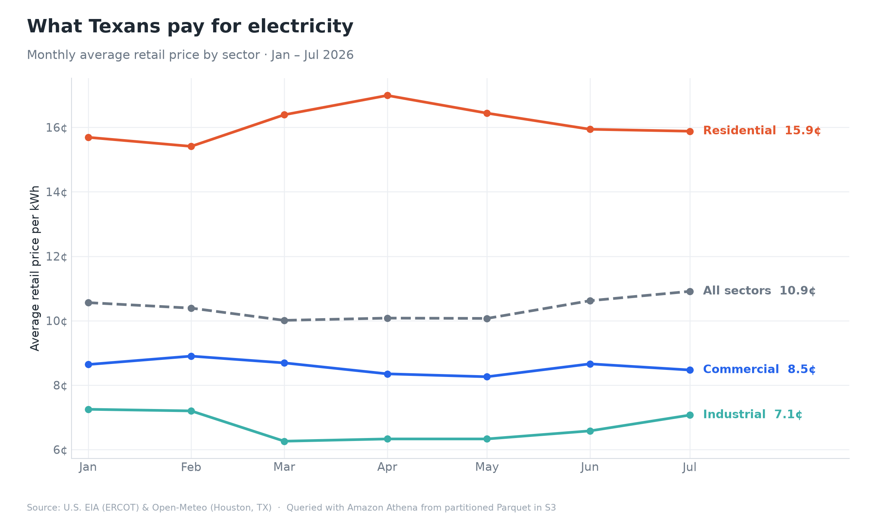
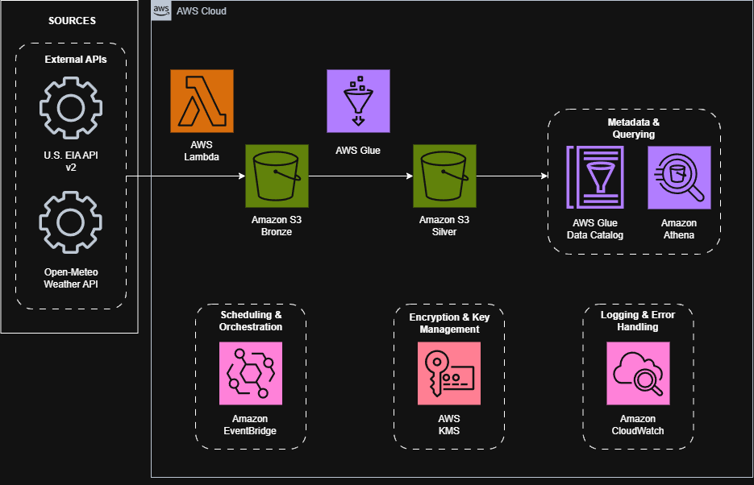

# ⚡ Texas Energy & Weather Serverless Data Lakehouse

[](https://www.terraform.io/)
[](https://aws.amazon.com/)
[](https://spark.apache.org/)
[](https://www.python.org/)
[](https://aws.amazon.com/athena/)
[](https://github.com/features/actions)
[](LICENSE)

An automated, serverless end-to-end Data Lakehouse on AWS provisioned with modular Infrastructure as Code (Terraform). The pipeline ingests hourly power grid data from the **U.S. Energy Information Administration (EIA v2 API)** and weather measurements from **Open-Meteo**, cleans and partitions records into Snappy Parquet using **AWS Glue (PySpark)**, and exposes the data for analytical querying via **AWS Glue Data Catalog** and **Amazon Athena**.

---

## 📊 Live Analytical Insights (Served from Amazon Athena & S3 Silver Parquet)

All visualizations below are rendered directly by [`scripts/generate_athena_visuals.py`](scripts/generate_athena_visuals.py), which executes serverless Presto/Trino SQL queries in **Amazon Athena** against the partitioned Snappy Parquet lake in the **S3 Silver bucket** (~58,000+ records across January–October 2026, scanning just **2–416 KB per query** in under **1 second**).

### 1. Summer Heat Drives the Texas Grid (10-Month Daily Timeline)


> **Key Finding:** Across 269 complete days from January to September 2026, ERCOT day-ahead demand tracks seasonal Houston air temperatures closely—climbing from a mild spring baseline (~45–50 GW) to a summer peak forecast of **91.9 GW** during August heatwaves.

### 2. The Grid's "Hockey Stick" (6,500 Hourly Observations)


> **Key Finding:** Joining 6,500 hourly ERCOT demand records with Houston weather reveals the classic non-linear "hockey stick" curve: demand increases modestly during winter heating hours (<10°C), flattens in mild 15–20°C weather (**47.6 GW** median), and surges **+80%** (to **85.4 GW** median) once ambient temperatures exceed 33°C.

### 3. When Texas Uses the Most Power (Month × Hour Heatmap)


> **Key Finding:** Winter months (January) exhibit a dual-peak profile with a morning heating ramp at **08:00–09:00 CST (59 GW)**, whereas summer months (June–September) shift to an intense late-afternoon air-conditioning peak at **16:00–18:00 CDT**, topping out at **88.7 GW** in August at 17:00.

### 4. What Powers Texas, Week by Week (Fuel Mix Evolution)


> **Key Finding:** Carbon-free wind and utility-scale solar accounted for **29% to 56% of weekly ERCOT electricity supply** across 2026, while natural gas flexing provided the dispatchable thermal backbone during peak summer loads.

### 5. The Texas Summer Duck Curve & Battery Arbitrage


> **Key Finding:** On an average summer day (Jun–Aug 2026), utility-scale solar peaks at **30 GW at 14:00 CDT**, carving a deep midday belly in net load. Grid-scale batteries absorb surplus midday generation (**charging up to 6.7 GW** between 08:00 and 13:00) and **discharge up to 7.6 GW** into the steep 19:00–21:00 evening ramp as solar drops off.

### 6. Sunshine In, Megawatts Out (Cross-Source Validation)


> **Key Finding:** Joining two completely independent upstream APIs in Athena—statewide ERCOT solar generation (EIA) and single-point direct normal irradiance in Houston (Open-Meteo)—shows a strong positive correlation (**r = 0.63** across 225 days), with summer months clustering at higher output due to longer daylight hours and seasonal capacity additions.

### 7. What Texans Pay for Electricity by Sector


> **Key Finding:** Monthly EIA retail sales data shows residential rates averaging **15.4¢–17.0¢/kWh** (ending July 2026 at **15.9¢/kWh**), roughly double commercial (**8.5¢/kWh**) and industrial (**7.1¢/kWh**) rates.

---

## 🏛️ Architecture & Data Flow



* **1. External APIs (`SOURCES`):** Pulls hourly ERCOT demand forecast, fuel-type generation, and monthly retail sales from the **U.S. EIA API v2**, alongside hourly temperature, solar irradiance, and wind speed from the **Open-Meteo Weather API**.
* **2. Ingestion Zone (`AWS Lambda` $\rightarrow$ `Amazon S3 Bronze`):** Triggered daily by **Amazon EventBridge** (`06:00 UTC`), the Python 3.12 collector stores raw immutable `payload.json` files paired with SHA-256 cryptographic `metadata.json` manifests.
* **3. Transformation Zone (`AWS Glue` $\rightarrow$ `Amazon S3 Silver`):** Triggered daily at `06:30 UTC`, the **AWS Glue 4.0 PySpark** job deduplicates primary keys, routes malformed records to a `quarantine/` prefix, and writes Snappy-compressed Parquet partitioned by `year=YYYY/month=MM`.
* **4. Metadata & Querying (`AWS Glue Data Catalog` + `Amazon Athena`):** External tables use **Athena Partition Projection** (zero-crawler latency/cost) to serve sub-second Presto/Trino SQL queries directly over **Amazon S3 Silver**.
* **5. Cross-Cutting Operational Pillars:**
  * **Scheduling & Orchestration (`Amazon EventBridge`):** Automates daily ingestion (`06:00 UTC`) alongside the scheduled AWS Glue ETL trigger (`06:30 UTC`).
  * **Encryption & Key Management (`AWS KMS`):** Encrypts all S3 buckets, Glue jobs, Athena query results, and logs with a single Customer-Managed Key.
  * **Logging & Error Handling (`Amazon CloudWatch`):** Streams execution logs and metrics for Lambda and Glue while malformed records are isolated in S3 quarantine.

---

## 🚀 Key Engineering Highlights

### 1. Zero Standby Cost Cloud Economics
* The entire data lake architecture (S3, Lambda, EventBridge, Glue Jobs, Glue Catalog, Athena) is **100% serverless**.
* When idle, compute cost is **$0.00/hour**. The only continuous charge is the customer-managed KMS key (~$1.00/month).
* Athena queries scan less than 5 KB of columnar Parquet per analytical query, costing fractions of a millicent.

### 2. Athena Partition Projection (Zero-Crawler Lakehouse)
* Instead of running costly AWS Glue Crawlers ($0.44/hour/DPU) or manual `MSCK REPAIR TABLE` commands to discover new data folders, tables are configured with **Athena Partition Projection** (`projection.enabled = "true"`).
* Athena calculates temporal partition paths (`year: 2020-2030`, `month: 1-12`) in memory from metadata rules. Newly ingested or backfilled data is **instantly queryable with zero latency**.

### 3. Decoupled Artifacts Architecture
* Build artifacts (Lambda zip packages, PySpark transformation scripts, Spark event logs, and Athena query output CSVs) are completely decoupled from data landing zones and stored in a dedicated `texas-data-pipeline-prod-artifacts` bucket.
* Prevents data retention lifecycle rules (e.g., Glacier transitions) from corrupting deployment scripts.

### 4. Primary-Key Deduplication & Data Quality Gate
* Bronze S3 is append-only with unique `request_id` UUID prefixes, ensuring multiple manual or scheduled runs never overwrite raw history.
* The PySpark transformation enforces strict primary-key deduplication (`dropDuplicates` on `period` for ERCOT, `time` for weather) to guarantee idempotency. Malformed records are routed to `s3://.../silver/quarantine/`.

### 5. Shift-Left CI/CD Automation (GitHub Actions)
* Automated pipeline ([`.github/workflows/ci.yml`](.github/workflows/ci.yml)) triggers on every push and pull request.
* Validates Python syntax (`py_compile`), enforces linting (`flake8`), executes 10 unit tests (`unittest`), builds the Lambda artifact, and verifies Terraform canonical formatting and syntax across all modules.

---

## 📂 Repository Structure

```text
aws-data-pipeline-terraform/
├── .github/
│   └── workflows/
│       └── ci.yml               # GitHub Actions CI pipeline (Lint, Test, IaC Validate)
├── collector/
│   ├── collect_raw_data.py      # Core Python API collector (EIA v2 + Open-Meteo)
│   ├── lambda_handler.py        # Serverless AWS Lambda entry point
│   ├── lambda_requirements.txt  # Bundled Lambda dependencies
│   ├── backfill_year_2026.sh    # Historical archive batch runner
│   └── backfill_june_2026.sh    # Fixed monthly backfill runner
├── glue/
│   └── transform_raw_to_refined.py # PySpark ETL (Bronze JSON -> Partitioned Silver Parquet)
├── modules/
│   ├── athena/                  # Glue Database, Athena Workgroup & Partition Projected Tables
│   ├── eventbridge/             # Scheduled cron rules & Lambda permissions
│   ├── glue/                    # AWS Glue Job, IAM roles, S3 script upload & Glue Trigger
│   ├── iam/                     # Least-privilege IAM roles for Lambda execution
│   ├── kms/                     # Customer-managed KMS key with automatic rotation
│   ├── lambda/                  # Lambda function packaging & CloudWatch logging
│   └── s3/                      # S3 bucket module with SSE-KMS, versioning & public block
├── envs/
│   ├── dev/                     # LocalStack development environment
│   └── prod/                    # Live AWS production environment
├── scripts/
│   ├── package_lambda.py        # Automated Lambda zip packaging utility
│   ├── test_athena.sh           # CLI SQL test runner with clean tabular output
│   └── generate_athena_visuals.py # Athena SQL query & Matplotlib visualization generator
├── tests/
│   └── test_collector.py        # Python unit test suite (Mocks, retries, checksums)
├── docs/
│   └── images/                  # AWS architecture diagram & Athena analytical charts
└── log_book.md                  # Comprehensive chronological engineering journal
```

---

## 🛠️ Quickstart & Local Verification

### 1. Clone & Set Up Python Environment
```bash
git clone git@github.com:JDGR33/aws-data-pipeline-terraform.git
cd aws-data-pipeline-terraform
python3 -m venv .venv
source .venv/bin/activate
pip install -r collector/requirements.txt
```

### 2. Run Python Unit Tests
```bash
python -m unittest discover tests/
```

### 3. Build the Lambda Ingestion Package
```bash
python scripts/package_lambda.py
```

### 4. Validate Terraform Infrastructure
```bash
terraform fmt -check -recursive
terraform -chdir=envs/prod validate
```

---

## 🚀 Live AWS Deployment & Testing

### 1. Deploy Infrastructure to AWS
Authenticate with your AWS CLI and deploy the production environment:
```bash
aws sso login --profile dev
terraform -chdir=envs/prod init
terraform -chdir=envs/prod apply
```

### 2. Run End-to-End Athena SQL Verification
Execute the automated test script to query your live partitioned data lakehouse:
```bash
./scripts/test_athena.sh dev
```

### 3. Generate Analytical Visuals
Run the visualization generator to query Athena and update the charts:
```bash
python scripts/generate_athena_visuals.py
```

### 4. Historical Backfills
To backfill historical 2026 data directly to Bronze S3:
```bash
AWS_PROFILE=dev RAW_BUCKET=texas-data-pipeline-prod-bronze DESTINATION=s3 START_MONTH=01 END_MONTH=09 ./collector/backfill_year_2026.sh
```

---

## 📜 Engineering Journal & Documentation
* **Chronological Engineering Log:** See [`log_book.md`](log_book.md) for detailed daily entries, architectural decisions, and troubleshooting war stories.

---

## 📄 License
This project is licensed under the MIT License - see the [LICENSE](LICENSE) file for details.
